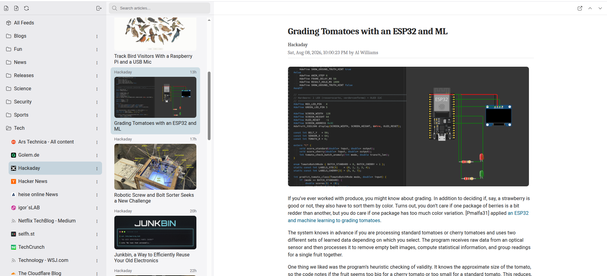

<p align="center">
  
</p>

<h1 align="center">FeedBox</h1>
<h3 align="center">Put all your feeds into a box!</h3>

<p align="center">
  <!-- Build / CI -->
  <!-- <a href="https://github.com/felixzmn/feedbox/actions">
    
  </a> -->
  <!-- Latest Release -->
  <a href="https://github.com/felixzmn/feedbox/releases">
    
  </a>
  <!-- Docker Image -->
  <a href="https://ghcr.io/felixzmn/docker/feedbox">
    
  </a>
  <!-- Helm Chart -->
  <a href="https://ghcr.io/felixzmn/helm/feedbox">
    
  </a>
  <!-- License -->
  <a href="./LICENSE">
    
  </a>
</p>



# What is FeedBox?

FeedBox is a simple, self-hosted feed reader built with Java.  
It allows you to manage all your feeds in one place—without ads, tracking, AI, or other distractions.

# Features

Feature highlights include:

- Fully self-hostable
- Automatic dark mode
- Mobile and desktop views
- Import and export feeds as OPML
- Organize feeds into folders
- Periodic background refresh

# Installation

It is possible to run FeedBox via Docker or deploy it to a Kubernetes cluster using the provided Helm chart. In both cases, a PostgreSQL database is required.

FeedBox uses Quarkus configuration directly. Set the JDBC URL in the environment (or via config files):

- `QUARKUS_DATASOURCE_JDBC_URL`: e.g. `jdbc:postgresql://<host>:<port>/<db>?user=<user>&password=<password>`

Optional overrides:

- `QUARKUS_HTTP_PORT`: HTTP port (default `8080`)
- `APP_HTTP_USER_AGENT` — defaults to `FeedBox/<version>` from `application.properties`

If you use the Helm chart, the default service port is `8080`.

## Docker

To run FeedBox using Docker, first start a PostgreSQL container, then run the FeedBox container. For testing purposes, you can use the following commands - for production, make sure to follow best practices regarding security and data persistence.

```bash
docker network create appnet

docker run -d --name postgres \
  -p 5432:5432 \
  -e POSTGRES_USER=user \
  -e POSTGRES_PASSWORD=password \
  -e POSTGRES_DB=postgres \
  --network appnet \
  postgres

docker run --rm --name feedbox \
  -p 8080:8080 \
  --network appnet \
  ghcr.io/felixzmn/docker/feedbox:latest
```

## Helm

For installing via Helm, use the following command:

```bash
helm install feedbox oci://ghcr.io/felixzmn/helm/feedbox --version <VERSION>
```

Default configuration values can be found in `values.yaml` in the Helm chart. You can override these values by providing a custom `values.yaml` file or using `--set` flags.

## Configuration Parameters

The following environment variables / properties can be configured:

| Parameter                          | Default         | Description                          |
| ---------------------------------- | --------------- | ------------------------------------ |
| `QUARKUS_DATASOURCE_JDBC_URL`      | -               | ! Database connection URL (required) |
| `QUARKUS_DATASOURCE_JDBC_MAX_SIZE` | `16`            | Maximum connection pool size         |
| `QUARKUS_OIDC_AUTH_SERVER_URL`     | -               | ! IdP issuer / OIDC discovery URL (required) |
| `QUARKUS_OIDC_CLIENT_ID`           | -               | ! OIDC client id (required)          |
| `QUARKUS_OIDC_CREDENTIALS_SECRET`  | -               | Client secret (confidential clients) |
| `QUARKUS_OIDC_TOKEN_STATE_MANAGER_ENCRYPTION_SECRET` | - | ! 32+ char secret encrypting the session cookie (required) |
| `QUARKUS_OIDC_AUTHENTICATION_SESSION_AGE_EXTENSION` | `30d` | How long past the ID-token lifespan the session cookie (and thus the refresh token) is kept; match the IdP refresh-token validity |
| `APP_SSO_BUTTON_LABEL`             | `Sign in with SSO` | Login-panel button text (multi-IdP-ready) |
| `QUARKUS_HTTP_PORT`                | `8080`          | HTTP port for the application        |
| `APP_HTTP_USER_AGENT`              | `FeedBox/<ver>` | User agent string for HTTP requests  |
| `APP_HTTP_TIMEOUT`                 | `30`            | HTTP request timeout in seconds      |
| `APP_HTTP_MAX_REDIRECTS`           | `5`             | Max redirects when fetching feeds/icons |
| `APP_HTTP_ALLOWED_PORTS`           | `80,443`        | Allowed outbound ports (SSRF guard)  |
| `APP_HTTP_MAX_BYTES_FEED`          | `10485760`      | Max feed response size (10 MiB)      |
| `APP_HTTP_MAX_BYTES_ICON`          | `2097152`       | Max favicon response size (2 MiB)    |
| `REFRESH_JOB_INTERVAL`             | `1h`            | Background feed refresh interval     |
| `REFRESH_CONCURRENCY`              | `10`            | Max parallel feed refreshes          |
| `IMPORT_CONCURRENCY`               | `5`             | Max parallel feed creates on OPML import |
| `IMPORT_MAX_OUTLINES`              | `5000`          | Max feed outlines accepted in one OPML import |
| `ARTICLES_RETENTION_DAYS`          | `90`            | Delete read articles older than N days after refresh (`0` disables); unread never deleted |

### Authentication notes

FeedBox uses **Quarkus OIDC web-app** (authorization code + PKCE). Tokens live in
encrypted **httpOnly** session cookies (ID + refresh only; access token is not
stored) — the SPA never sees them. When the ID token expires, Quarkus uses the
refresh token on the next request. The session cookie’s `Max-Age` is the ID-token
lifespan plus `quarkus.oidc.authentication.session-age-extension` (default
`30d`, Authentik’s stock refresh-token validity). Override with
`QUARKUS_OIDC_AUTHENTICATION_SESSION_AGE_EXTENSION` if the provider’s
refresh-token validity differs; Quarkus cannot read that lifetime from an opaque
refresh token. A shorter value drops a still-valid refresh token early; a longer
value only means the cookie outlives the token and the next call shows the login
panel.

Register this **exact** Redirect URI at the IdP (Authentik → Application →
Provider → Redirect URIs):

- Local: `http://localhost:8080/oidc`
- Prod: `https://<your-host>/oidc`

(The old SPA used `http://localhost:8080` without `/oidc` — that no longer
matches.) Logout is `GET /logout` (returns to `/` and shows an in-app Sign in
panel). Sign in navigates to `/start`, which triggers the OIDC challenge.
Customize the button label with `APP_SSO_BUTTON_LABEL` / `app.sso.button-label`
(e.g. `Sign in with Authentik`); the shell loads providers from
`GET /api/public/auth-providers`.

If TLS terminates at a reverse proxy/Gateway and OIDC builds
`redirect_uri` as `http://…` instead of `https://…`, put the Quarkus proxy
settings in the chart `config` map (e.g. `quarkus.http.proxy.proxy-address-forwarding=true`
and the related `allow-x-forwarded` / `enable-forwarded-*` keys). Do **not**
set these for plain-HTTP deployments.

FeedBox is **single-tenant**: any user who can complete login at the configured
IdP gets full read/write access. Restrict access at the IdP (group / application
assignment).

# Local Development

## Prerequisites

- PostgreSQL (e.g. via Docker)
- Java
- Maven

## Commit scopes

| Scope     | Description           |
| --------- | --------------------- |
| `backend` | Java-code             |
| `ui`      | Frontend related code |
| `deps`    | Dependencies          |
| `docs`    | Documentation         |

## Configuration

`src/main/resources/application.properties` holds **safe defaults only** (user agent, timeouts, Flyway, etc.). It is packaged into the JAR and Docker image.

Secrets and environment-specific values (database URL, OIDC) belong in:

| Environment | Where to put secrets |
| ----------- | -------------------- |
| Local dev (`mvn quarkus:dev`) | `application-local.properties` in the project root (gitignored) |
| Docker / Kubernetes | Environment variables (see table above) |

First-time local setup:

```bash
cp application-local.properties.example application-local.properties
# edit application-local.properties with your values
# required: quarkus.oidc.auth-server-url, client-id, encryption-secret
# register http://localhost:8080/oidc as the IdP redirect URI
```

## Tests

```bash
# Unit tests (Mockito; no Docker)
./mvnw test

# Unit + integration tests (Postgres Dev Services / Testcontainers; needs Docker)
./mvnw verify -DskipITs=false

# Frontend unit tests
npm run test:frontend
```

## Build the application

```bash
mvn install
# native (optional, needs GraalVM or container-build):
mvn package -Dnative -Dquarkus.native.container-build=true
```

Run the application:

```bash
mvn quarkus:dev
# or, for a built native runner with a local config file:
java -Dquarkus.config.locations=application-local.properties -jar target/*-runner.jar
```

Docker images are published automatically on every release to `main`. See [release.md](./release.md).

# Release Process

Releases are fully automated (conventional commits → SemVer tag → native image → GHCR).  
Details: [release.md](./release.md).

# Icons

[Icons from Tabler Icons.](https://tablericons.com/)\
[PWA Icon generated with maskable](https://maskable.app/editor)
